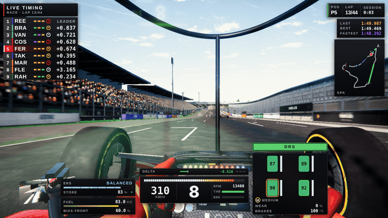

# APEX — a first-person Formula 1 racing game

A browser-and-desktop F1 racing game built in Three.js: 120 Hz physics, a full race
weekend against ten AI-driven teams at Spa-Francorchamps, and a AAA-style render
pipeline (temporal anti-aliasing, motion blur, bloom, heat haze, dynamic weather,
night racing) — developed in review loops against real shipped titles.



## Play it

Requires [Node.js](https://nodejs.org) 20.19+ or 22.12+ (the versions Vite 7 supports).

```bash
npm install
```

**As a desktop app** (its own window, no browser):

```bash
npm run app
```

**In the browser** (development server with live reload):

```bash
npm run dev
```

then open http://localhost:5173.

**Build a portable Windows .exe** (lands in `release/`):

```bash
npm run dist:win
```

**From VS Code**: open the folder and press F5. "Play APEX (Chrome)" starts the dev
server and opens the game; "Play APEX (Edge)" and "Play APEX (Desktop window)" are in
the same Run and Debug dropdown. The launch configs and tasks live in `.vscode/`.

Step-by-step instructions, packaging details and what to try if it runs slowly are in
[docs/RUNNING.md](docs/RUNNING.md).

## Controls

| Action | Keyboard | Gamepad |
|---|---|---|
| Throttle / brake | W / S (or ↑ / ↓) | triggers |
| Steer | A / D (or ← / →) | left stick |
| Shift up / down | Shift or E / Ctrl or Q | RB / LB (R1 / L1) |
| DRS | Space | A / cross |
| ERS deploy | F | X / square |
| Pit limiter | L | — |
| Cycle camera | C | Y / triangle |
| Look left / right / back | Z / X / M | — / — / left-stick click |
| Toggle HUD | H | — |
| Reset car | R | B / circle |
| Pause menu | Esc | View or Menu / Share or Options |
| FPS counter | `` ` `` (backtick) | — |

Esc opens the pause menu: resume, restart the session, settings (the same live settings
as the main menu) and quit to the main menu. Arrow keys and Enter (or the mouse) drive
it; Esc resumes, or steps back out of the settings screen. The backtick key toggles a
counter showing frame rate, frame time and draw calls.

The main menu covers session type (Practice / Qualifying / Race), race distance, team
and driver selection, four AI difficulty levels, and a settings screen (quality tier,
field of view, motion blur, film grain) that writes through to the live game. The
controls page in the menu reads the real key bindings from the input code, so it never
drifts out of date (the backtick FPS toggle is the one key it leaves off).

If the game lags on a dual-GPU laptop, make sure the browser (or the app) is allowed
to use the high-performance GPU: Windows Settings → System → Display → Graphics. The
FPS counter shows whether a change helped.

## For developers

Everything simulates on a fixed 120 Hz step (physics substeps to 240 Hz) with
interpolated presentation, so the feel is identical at any display rate. Systems live
under `src/` (car physics, track, sky, render pipeline, effects, AI, audio, UI) and
communicate through a shared `ctx` object; the interface contract is `CONTRACT.md`.

### Docs

- [docs/RUNNING.md](docs/RUNNING.md) — running, building and packaging the game, from
  VS Code or a terminal, and what to try if it runs slowly.
- [docs/TECHNICAL-NOTES.md](docs/TECHNICAL-NOTES.md) — where the reasoning behind the
  code lives: bug workarounds, justified constants and traps, each tied to the file it
  concerns.
- [docs/GOING-NATIVE.md](docs/GOING-NATIVE.md) — what the screen-space effects here
  really are, how AAA studios build games, and the honest options for taking APEX to a
  native engine.
- [docs/JOURNAL.md](docs/JOURNAL.md) — the development story: every round, bug hunt
  and lesson.

### Tools

All verification happens headlessly, because the original build machine had no GPU:

```bash
node tools/screenshot.mjs --all --fast
```

boots the built game in headless Chromium (SwiftShader), drives it to deterministic
scenarios (grid start, 310 km/h straight, wet weather, night race…) and writes PNGs,
failing on console errors or blank frames. Also:

- `tools/verify-gameplay.mjs` — simulates a fixed stretch of race time with no
  graphics (420 s by default, or the number of seconds you pass), with the player
  held flat out in a straight line, and prints a JSON report: top speeds and gears,
  field speed percentiles, off-track time, any NaN samples, standings and laps. It
  has no pass/fail checks and does not exit non-zero on bad numbers, so read the
  report. It does not start a server: run `npm run build`, then keep
  `npm run preview` running on port 4173 (the VS Code task "APEX: verify gameplay"
  needs that too).
- `tools/analyse.mjs` — brightness/contrast statistics for a screenshot.
- `tools/speckle-oracle.mjs` — regression check for the engine-cover speckle bug
  (measures the heat-haze effect's pixel damage with the effect on, off, and neutered).
- `tools/probe-shift.mjs` — measures yaw disturbance through gear shifts.
- `tools/make-gif.mjs` — renders a deterministic clip and encodes it as a GIF
  (`--shot straight|chase|apex|pack|grid`); the README clip came from this.

Screenshot scenarios and quality tiers are pinned so that captures are reproducible;
compare metrics on/off on the same machine and build, never across machines.
